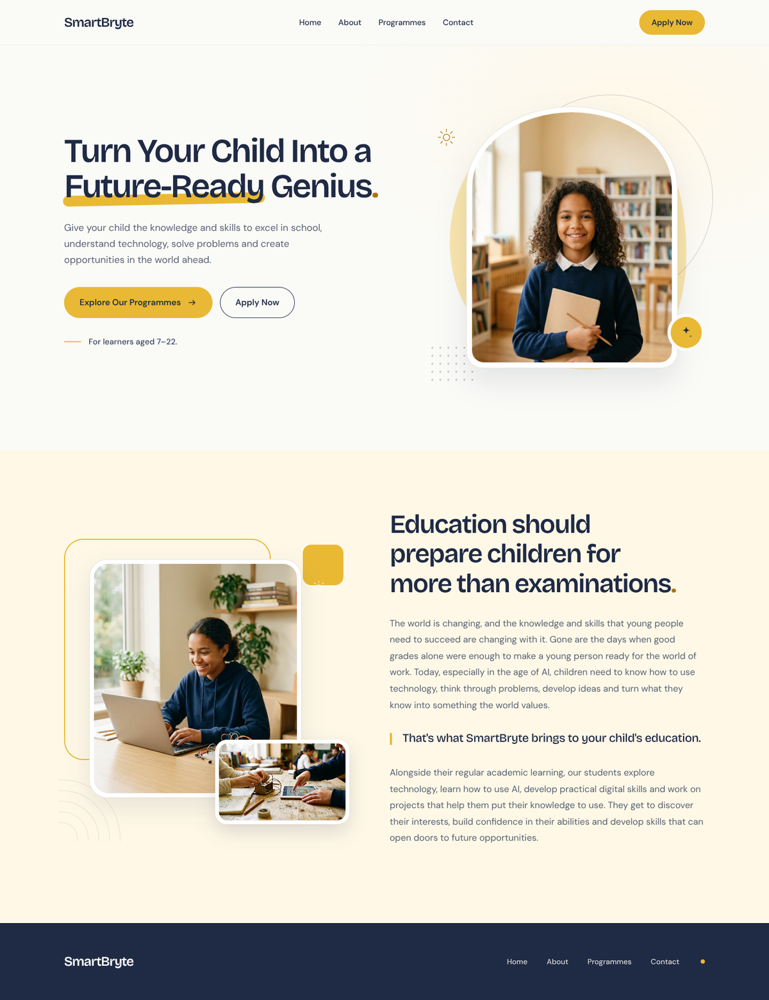

# SmartBryte — Homepage

A single, responsive homepage for SmartBryte, built as a static frontend. It is the
implementation of the **SmartBryte – Lovable Homepage Master Prompt** brief: the PDF
controls the product scope, architecture and every word of copy; the attached design
images and the two Markdown design-system files guide the visual direction.

## 👀 See the design

**[PREVIEW.md](PREVIEW.md) lists every preview option.** The quickest one needs nothing
but this GitHub page — here is the full desktop homepage:



Also available: [tablet](preview/tablet.png) · [mobile](preview/mobile.png) ·
[full-page PDF](preview/smartbryte-homepage.pdf) ·
[standalone offline HTML for Chrome](smartbryte-preview.html).

## Run it

```bash
npm install
npm run dev        # http://localhost:5173  (binds 0.0.0.0 for preview environments)
npm run build      # type-check + production build into dist/
npm run preview    # serve the production build
```

No backend, database, authentication, payments, dashboards or additional pages.

## Preview it in Chrome (no build required)

**`smartbryte-preview.html`** at the repository root is a single, self-contained
snapshot of the finished homepage. The stylesheet, both variable fonts and all three
photographs are embedded as data URIs, so there are no external requests at all.

1. Download `smartbryte-preview.html` from GitHub (use **Download raw file** on the
   file page, or save the raw view as `.html`).
2. Double-click it — Chrome opens it directly via `file://` with no server, no
   `npm install` and no internet connection.

The responsive layouts and the mobile menu work in the standalone file too. Note that
opening a `raw.githubusercontent.com` URL in Chrome shows the source as text rather
than rendering it; the file must be saved locally first.

**For a shareable `https://` URL:** a second copy is committed at `docs/index.html`.
Enable GitHub Pages at
<https://github.com/Beewrld/Smartbryte/settings/pages> — **Deploy from a branch**,
choose `arena/38c48503-smartbryte` and `/docs`, then Save. That publishes the preview
at `https://beewrld.github.io/Smartbryte/`. Pages is **not** enabled yet because
repository settings are outside this session's GitHub permissions; see
[PREVIEW.md](PREVIEW.md#4-github-pages--a-native-shareable-https-url-one-time-setup).

Regenerate both files after any design change with:

```bash
npm run build:preview
```

The preview is generated from the same `App.tsx`, `content.ts` and `styles.css` as the
app, so it cannot drift away from the real page.

## Design synthesis

The page is **warm editorial education** — one coherent system rather than a copy of
any single reference:

| Borrowed from | Principle used |
| --- | --- |
| SchulFlow | Warm cream/gold palette, deep navy type, learner photography, spacious horizontal bands, tidy visual groupings |
| EduAct / EduKa / the course template | Split hero, abstract organic shapes, thin circular line-work, overlapping layered image frames, clear CTA hierarchy |
| `DESIGN (1).md` (Humble) | Expressive display type with tight tracking, flat paper surfaces, generous whitespace, one accent used as punctuation, large rounded image frames, alternating two-column rhythm |
| `DESIGN (2).md` (Quizlet) | Approachable geometric sans, calm canvas, one gentle shadow, pill CTAs, 8px spacing rhythm |

Humble's safety orange and Quizlet's violet are deliberately **not** used. Golden yellow
is the only chromatic accent, on a warm off-white canvas with deep navy ink — the
combination recommended by the brief and reinforced by the school-oriented references.
The hero uses an arched portrait on an organic gold shape; the introduction uses a
layered, overlapping photo collage. Both headlines end with the same restrained gold
full stop, and "Future-Ready" carries a marker-pen highlight. All other decoration is
wordless.

Tokens live at the top of `src/styles.css` (`--paper`, `--cream`, `--ink`, `--slate`,
`--gold`, …), with responsive rules at the bottom of the same file.

## Content integrity

All visible copy is locked in `src/content.ts` and reproduced **verbatim** from the
brief's canonical block. The only other text on the page is the brand name and the four
navigation labels permitted by §4A/§4D. There are no invented taglines, statistics,
testimonials, programme descriptions, contact details, legal links or copyright years.
Sections with no approved copy were omitted rather than filled.

- `Home` and `About` point to the two sections that actually exist (`#home`, `#about`).
- `Programmes` and `Contact` are intentionally non-functional presentation links.
- The `Apply Now`, `Explore Our Programmes` and header CTA buttons are visible interface
  elements only. No destination, application flow or workflow was supplied, so none was
  invented.

This is deliberate, per §2 "Build scope and exclusions" and §8 of the brief.

## Imagery

The uploaded screenshots are references only — none of their faces, logos, dashboards or
branded UI is reused. The three photographs in `public/images/` were generated as
original, warm, natural-looking learner imagery (optimised to WebP) so the page has no
external image dependency and does not imply that a stock photo shows real SmartBryte
students. Descriptive alt text is used for the photographs; decorative shapes are
`aria-hidden`.

## Structure

```
index.html
src/
  main.tsx              entry, self-hosted variable fonts
  App.tsx               header / main / footer landmarks
  content.ts            LOCKED COPY — do not edit
  styles.css            tokens, components, responsive breakpoints
  components/
    Header.tsx          wordmark, nav, CTA, accessible mobile disclosure
    Hero.tsx            split hero + arched portrait composition
    Introduction.tsx    alternating two-column section + image collage
    Footer.tsx          minimal wordmark + repeated nav labels
    NavLinks.tsx        shared navigation labels
    Decorations.tsx     wordless inline SVG graphics
public/images/           three optimised WebP photographs
```

**Typography:** Bricolage Grotesque Variable for display, DM Sans Variable for body/UI —
both self-hosted through `@fontsource-variable`, so no font CDN is required.

**Accessibility & responsiveness:** semantic landmarks, one `h1` and one `h2`,
`prefers-reduced-motion` support, visible keyboard focus, ≥44px touch targets,
descriptive alt text, and deliberately stacked layouts at tablet/mobile widths with no
horizontal overflow. Verified at 320, 340, 360, 390, 480, 600, 768, 820, 900, 960,
1024, 1100, 1200, 1280, 1440 and 1600px.
